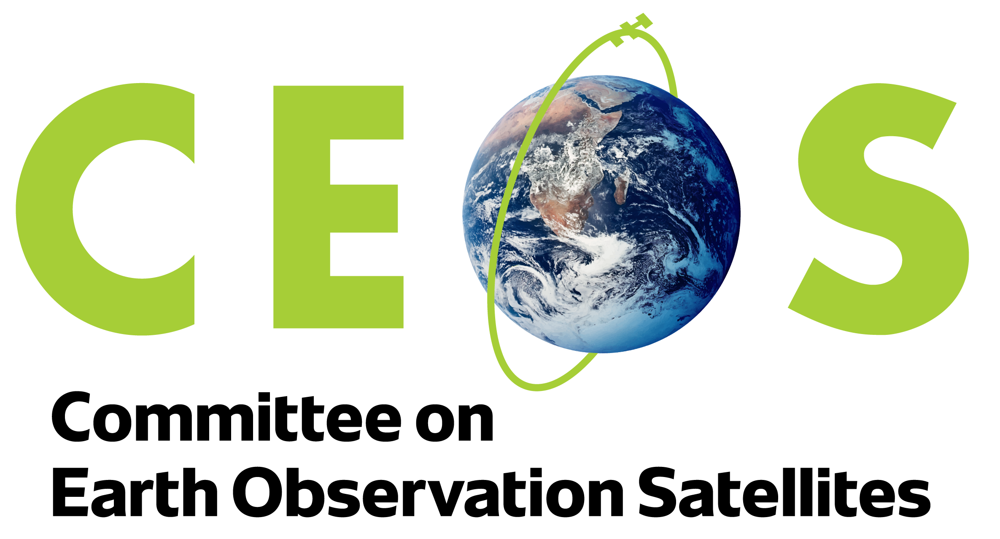

# CEOS Interoperability Handbook 2.0



Enhancing Interoperability of data and services between different Earth Observation stakeholders

**This document is CEOS Plenary approved Version 2.0. Please use the [Discussion](https://github.com/ceos-org/interoperability-handbook/discussions) section
to provide your comments and feedback, and please raise any Actions under [Issues](https://github.com/ceos-org/interoperability-handbook/issues)**.

You can [download a PDF of the current release (version 2.0.0) here](https://github.com/ceos-org/interoperability-handbook/releases/download/v2.0.0/interoperability-handbook.pdf).

## Table of Contents

- [**1. Introduction**](Introduction.md)
- [**2. Interoperability Framework**](Framework.md)
- [**3. Vocabulary (Semantics)**](Vocabulary.md)
- [**4. Architecture**](Architecture.md)
- [**5. Interface**](Interface.md)
- [**6. Quality**](Quality.md)
- [**7. Policy**](Policy.md)
- [**8. Conclusion and Future Scope**](Conclusion.md)

## Contributing checks

Pull requests run a markdown lint (markdownlint) and a spell check (pyspelling) in GitHub Actions. To run the same checks locally before committing:

```bash
brew install aspell        # or: sudo apt install aspell aspell-en
pip install pre-commit
pre-commit install         # run the checks automatically on each commit
pre-commit run --all-files # run them on demand
```

Words the spell checker wrongly rejects (names, acronyms) go in `.wordlist.txt`.

## License

Content in this repository is accessible under the [CC-BY 4.0 license](LICENSE).

## Contributors

Overall Coordination (WGISS), Tom Sohre (USGS), Nitant Dube (ISRO), Libby Rose

Factor Leads:

- **Vocabulary** (LSI-VC) Peter Strobl (EU Commission)
- **Architecture** (SEO and WGISS) Alex Leith (Auspatious), Mirko Albani (ESA)
- **Interface** (WGISS) Damiano Guerrucci (ESA)
- **Quality** (WGCV) Cody Anderson (USGS), Medhavy Thankappan (GA)
- **Policy** (CEO, SEO, WGISS, WGCV)

Public Review: OGC, CEOS COAST-VC, NASA, UKSA, UK NPL, DLR, NOAA
***
[NEXT](Introduction.md)
